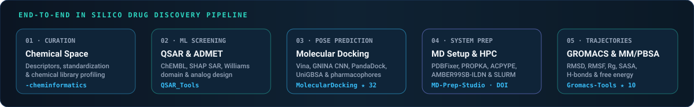
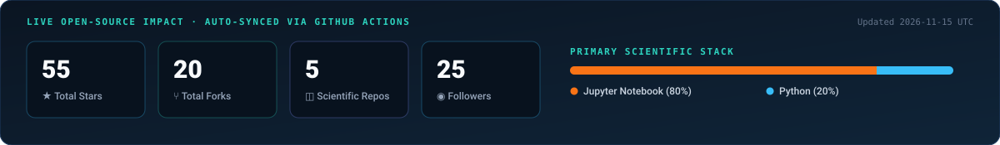

  

 

> **Chemist, Ph.D. in Chemical Sciences** (*Universidad Nacional de Rosario, Argentina*) · **M.Sc. in Pharmaceutical Sciences** (*Universidad de Cartagena*) · **B.Sc. in Chemistry** (*Universidad del Atlántico*).
>
> My research bridges **natural products chemistry and total synthesis** with **reproducible *in silico* drug discovery** — developing open-source workflows for **QSAR modeling**, **multi-engine molecular docking**, **GROMACS MD preparation**, and **binding free energy analysis**.

---

### 🌐 Interactive Portfolio & 3D Molecular Explorer
Explore my research pipeline, live repository metrics, BibTeX publication archive, and an **interactive 3D protein-ligand viewer** at **[sbolivar16.github.io](https://sbolivar16.github.io)**.

---

### 🧬 End-to-End *In Silico* Drug Discovery Ecosystem

  

 

| Stage | Repository | Highlights | 1-Click Launch |
| :--- | :--- | :--- | :--- |
| **MD System Setup** | [**MD-Prep-Studio**](https://github.com/Sbolivar16/MD-Prep-Studio) | Local web app (`PDBFixer` + `PROPKA` + `RDKit`/`ACPYPE` + `GROMACS` + SLURM + paper methods generator) |  |
| **Molecular Docking** | [**MolecularDocking**](https://github.com/Sbolivar16/MolecularDocking) | `AutoDock Vina`, `GNINA` CNN, `PandaDock`, `UniGBSA` rescoring & pharmacophore mapping (`32 ★`) |  |
| **QSAR & Screening** | [**QSAR_Tools**](https://github.com/Sbolivar16/QSAR_Tools) | Universal ChEMBL QSAR pipeline: RF/XGBoost/SVM, Williams domain, SHAP SAR, ADMET & analog design |  |
| **MD Analysis** | [**Gromacs-Tools**](https://github.com/Sbolivar16/Gromacs-Tools) | Trajectory diagnostics (`RMSD`, `RMSF`, `Rg`, `SASA`, H-bonds) & `g_MMPBSA` decomposition (`10 ★`) |  |
| **Cheminformatics** | [**-cheminformatics**](https://github.com/Sbolivar16/-cheminformatics) | Molecular descriptors (`Datamol`, `RDKit`), `OpenBabel` conversions & chemical space analysis |  |

---

### 📊 Live Open-Source Impact & Activity

  

 

  <picture>
    <source media="(prefers-color-scheme: dark)" srcset="https://raw.githubusercontent.com/Sbolivar16/Sbolivar16/output/github-contribution-grid-snake-dark.svg" />
    <source media="(prefers-color-scheme: light)" srcset="https://raw.githubusercontent.com/Sbolivar16/Sbolivar16/output/github-contribution-grid-snake.svg" />
    
  </picture>

---

### 📑 Interactive Research Dossier *(Click to Expand)*

<b>📚 Peer-Reviewed Publications (Auto-synced from ORCID)</b>

 

<!-- ORCID_PUBLICATIONS:START -->
| Year | Publication | Journal | Link |
|:---:|---|---|---|
| **2025** | Computational screening of natural products as tryptophan 2,3-dioxygenase inhibitors: Insights from CNN-based QSAR, molecular docking, ADMET, and molecular dynamics simulations | *Computers in Biology and Medicine* |  |
| **2024** | Drug repositioning for rosacea disease: Biological TARGET identification, molecular docking, pharmacophore mapping, and molecular dynamics analysis | *Computers in Biology and Medicine* |  |
| **2023** | Step-Economic Total Synthesis of Melosatin A from Eugenol | *ACS Omega* |  |
| **2018** | Total Synthesis of Waltherione F, a Nonrutaceous 3-Methoxy-4-quinolone, Isolated from Waltheria indica L. F. | *Organic Letters* |  |
| **2017** | Antiviral effect of compounds derived from the seeds of Mammea americana and Tabernaemontana cymosa on Dengue and Chikungunya virus infections | *BMC Complementary and Alternative Medicine* |  |
<!-- ORCID_PUBLICATIONS:END -->

<b>🎓 Academic Trajectory & Wet-Lab to In Silico Bridge</b>

 

| Period | Degree / Role | Institution | Focus |
|---|---|---|---|
| **2018 – 2024** | **Ph.D. in Chemical Sciences** | Universidad Nacional de Rosario (Argentina) | Total synthesis of natural products & organic chemistry |
| **2015 – 2017** | **M.Sc. in Pharmaceutical Sciences** | Universidad de Cartagena (Colombia) | Antiviral natural products (Dengue & Chikungunya) |
| **2008 – 2014** | **B.Sc. in Chemistry** | Universidad del Atlántico (Colombia) | Organic & analytical chemistry |

<b>🛠️ Computational & Scientific Stack</b>

 

---

**Always open to research collaborations in computational drug discovery, natural products, and open-source cheminformatics.**

&nbsp;

&nbsp;

  

